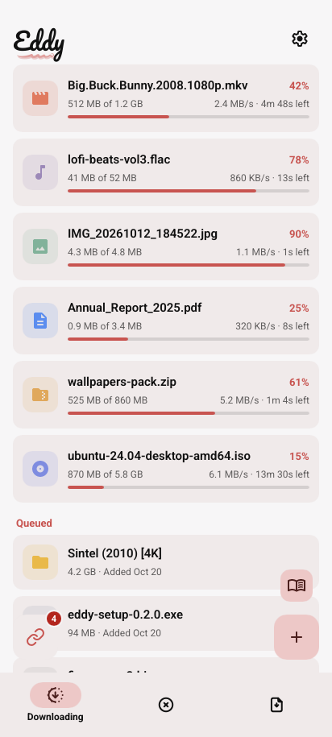
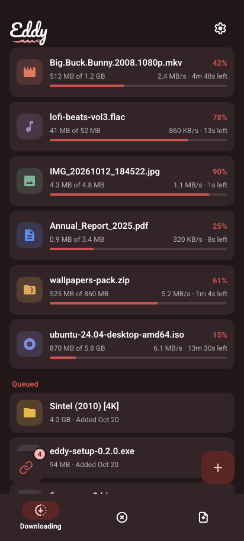
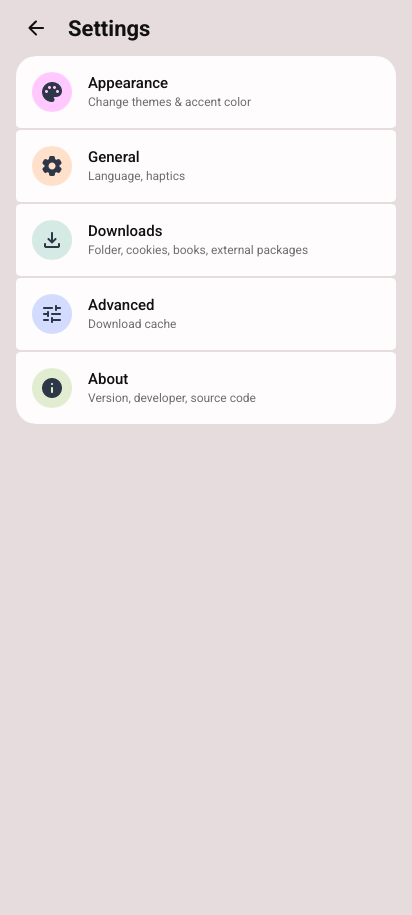
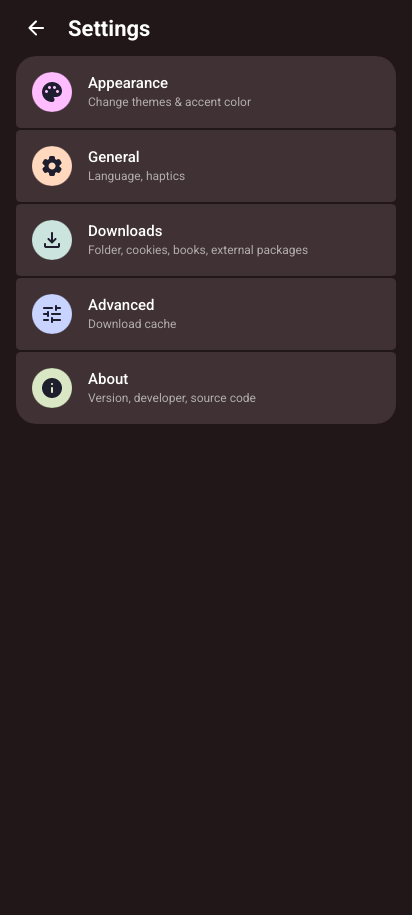
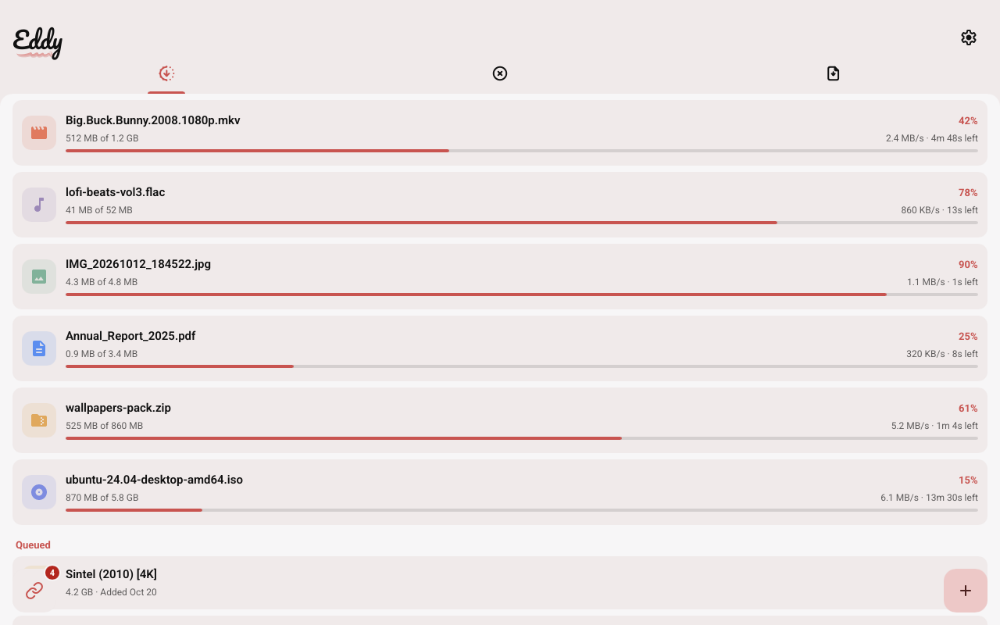
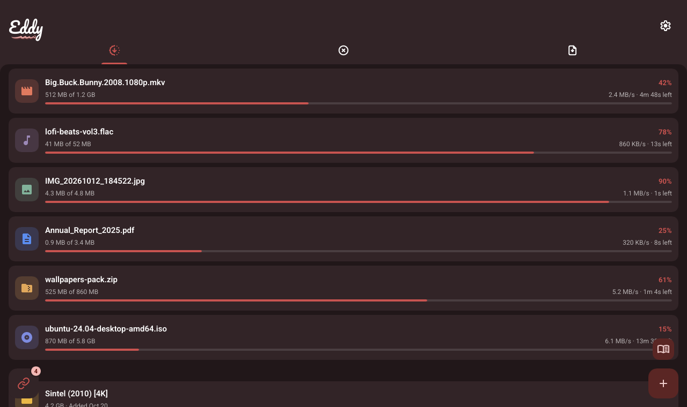
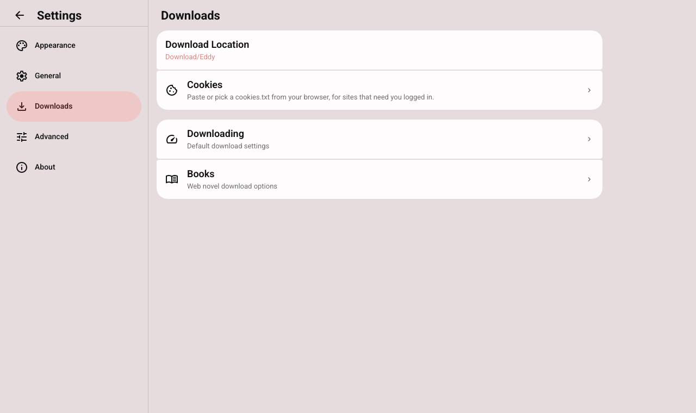
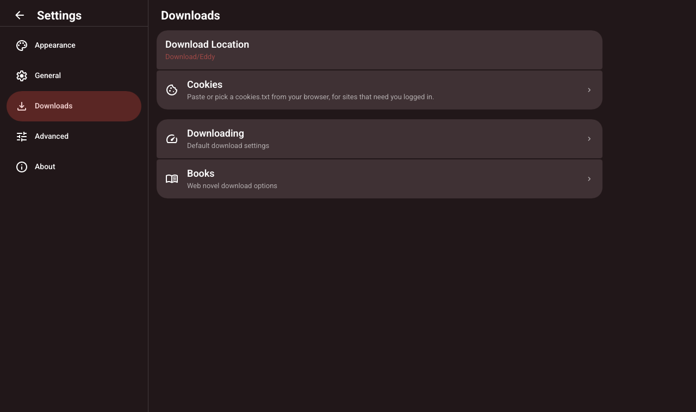

# Eddy

[](https://github.com/eddy-dl/eddy/releases/latest)

A download manager for Android, iOS, Windows, macOS and Linux, written in Rust with a [Slint](https://slint.dev)
interface.
Paste or share a link: Eddy works out what it is, shows a preview, and downloads it.

<p>
  
  
  
  
</p>
<p>
  
  
</p>
<p>
  
  
</p>

## What it downloads

- **Files**: plain links, with several connections, pause and resume, through a patched
  [aria2_rust](https://github.com/balovess/aria2_rust).
- **Torrents and magnet links**, picking which files to keep.
- **Videos and music** through yt-dlp, with Eddy's own extractors for TikTok (the best quality,
  others to pick from), Instagram and Pinterest. On Android, yt-dlp comes from
  [YTDLnis](https://github.com/deniscerri/ytdlnis)'s helper apps
  ([ytdlnis-packages](https://github.com/deniscerri/ytdlnis-packages)), which Eddy can fetch
  for you to install.
- **Galleries** (image boards, art and photo sites…) through
  [gallery-dl](https://github.com/mikf/gallery-dl), offered next to yt-dlp in the preview. On
  Android it runs on YTDLnis's Python, with gallery-dl itself fetched from PyPI; on desktop it's
  gallery-dl's own build, or one on your PATH.
- **Google Drive** and **MEGA** files and folders (MEGA's decrypted in place).
- **Web novels as EPUB books**: Royal Road, AO3, Wattpad, Sufficient Velocity, SpaceBattles,
  FanFiction.net, FictionPress, Wuxiaworld, NovelPing, NovelBin and Ranobes. Pick chapters, keep
  author notes and images or not, and check for new chapters later. Sites behind Cloudflare or Anubis are passed in a
  browser check. See [docs/novel-extractors.md](docs/novel-extractors.md).
- **Pages whose file only comes from a click**, in Eddy's own browser.

On iOS (a first build, sideloaded with AltStore, SideStore or Sideloadly), yt-dlp and gallery-dl
run in the app's own Python, with ffmpeg and a JavaScript engine built in, as iOS lets an app
start no other programs. It can't be on the App Store: Apple's review guidelines don't allow
torrent clients or saving media from sites like YouTube (5.2.3), nor an app downloading code,
as updating yt-dlp does (2.5.2).

Downloads go to `Download/Eddy` (by type, if you like) or a folder you pick.
English and French. The French translation was written by an AI model, not a translator, and
hasn't been checked by a native speaker: corrections are welcome.

## Building

For Android, you need Rust (edition 2024), the Android NDK and SDK (API 36), and
[cargo-ndk](https://github.com/bbqsrc/cargo-ndk).

```sh
# The Rust library, for 64-bit ARM phones (the APK takes it from target/)
cargo ndk -t arm64-v8a -P 26 build --lib --release

# The APK
cd platforms/android
./gradlew assembleRelease
```

The release build is signed with the keystore named by `KEYSTORE_FILE`, `KEYSTORE_PASSWORD`,
`KEY_ALIAS` and `KEY_PASSWORD`; the `releasetest` build type uses a debug keystore at the
repository's root (`debug.keystore`, not committed).

Android 8 (API 26) or newer.

On Windows and Linux, the desktop app is a plain Cargo build:

```sh
SLINT_STYLE=fluent cargo build --release --bin eddy-desktop
```

Links and files given on its command line (`eddy-desktop <link>… <file.torrent>…`, or the
releases' `eddy-linux-x86_64` and so on) open in the preview, in the window already open if
there is one. Settings → General can make it what Windows and Linux open magnet links and
`.torrent` files with.

To look at the interface without building the app, open it in `slint-viewer`:

```sh
slint-viewer --style material ui/app.slint
```

## Layout

| Path | What's there |
|---|---|
| `src/` | The app: links and previews (`links.rs`), the download list (`downloads.rs`), the downloaders (`downloader/`), extractors (`extractors/`), web novels (`novels/`), platform code (`platform/`) |
| `ui/` | The Slint interface: `app.slint`, components, settings pages, icons |
| `platforms/android/` | The Android app: Gradle, the download service, the browser check and Eddy's browser (Kotlin) |
| `platforms/ios/` | The iOS app: its Xcode project (XcodeGen) and build script; CI fetches Python, ffmpeg and QuickJS-ng into it |
| `patches/` | Patched crates: aria2_rust, and Slint's Android backend |
| `lang/` | Translations (gettext `.po`) |
| `tools/` | The icon and wordmark generators, and `sync_po.py` for the translations |
| `docs/` | Design notes |

## Logs

Warnings and errors are written to Eddy's own storage. Settings → Advanced → Debug can keep them
in `Download/Eddy/logs` instead, or share them for a bug report. They list the links you
download, so look at them before sending them anywhere.

## Credits

- [Palladium](https://github.com/tfourj/Palladium) by [tfourj](https://github.com/tfourj): Eddy's
  iOS port follows its approach: yt-dlp and gallery-dl in an embedded Python, yt-dlp's ffmpeg
  calls answered in-process, and JavaScriptCore with QuickJS as the JavaScript runtime for
  YouTube's challenges.
- [SwiftFFmpeg-iOS](https://github.com/tfourj/SwiftFFmpeg-iOS), also by tfourj: the ffmpeg and
  ffprobe Eddy's iOS app runs.
- [Python-Apple-support](https://github.com/beeware/Python-Apple-support) (BeeWare): the Python
  in the iOS app.
- [QuickJS-ng](https://github.com/quickjs-ng/quickjs): the iOS app's JavaScript fallback.
- [yt-dlp](https://github.com/yt-dlp/yt-dlp) and [gallery-dl](https://github.com/mikf/gallery-dl),
  which do the work for most sites; [aria2_rust](https://github.com/balovess/aria2_rust) for
  files and torrents; [YTDLnis](https://github.com/deniscerri/ytdlnis)'s packages on Android.

## License

Eddy is free software, under the GNU General Public License, version 3 or (at your option) any
later version: see [LICENSE](LICENSE). The patched crates in `patches/` keep their own licenses
(aria2_rust is GPL-3.0-or-later too; Slint's Android backend keeps Slint's).
